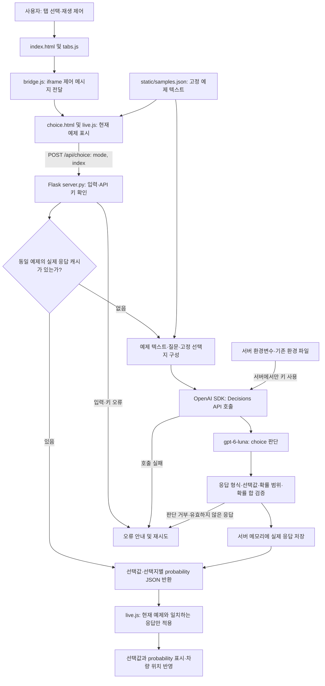

# 예제2 - 정해진 선택지 중에서 선택하는 Choice API

이 예제는 `gpt-6-luna` 모델에서 Descisions 의 choice API를 사용해서 정해진 선택지 중에서 선택하는 데모이다. 공식 [Decisions 가이드의 Select from fixed options](https://developers.openai.com/api/docs/guides/decisions?utm_source=chatgpt.com#select-from-fixed-options) 내 로컬 PC 또는 Mac 환경에서 실행하는 프로젝트이다.

- Driving: 표시된 장애물 배치에 해당하는 텍스트 설명으로 Lane 1/2/3을 판단한다. 화면의 이미지 자체를 분석하는 기능은 아니다. 차량은 API가 선택한 차선으로 이동한다.
- Team routing: 현재 고객 문의를 Billing / Technical support / Account access 중 하나로 분류한다.
- Document type: 현재 문서의 표시 텍스트를 Invoice / Receipt / Contract 중 하나로 분류한다.

공식 문서의 Driving / Team routing / Document type 사용자 인터페이스에 실제 Decisions API의 `choice` 판단을 연결다.

---

## 1. 실제 API 연결

실제 Decisions API를 연결하려면 `OPENAI_API_KEY`가 필요하다. 서버 환경 변수인 `.env`의 `OPENAI_API_KEY`를 작성한다.

`POST /api/choice`는 현재 표시되는 고정 예제의 모드와 인덱스만 받는다. 서버가 해당 증거를 `client.decisions.create(model="gpt-6-luna", questions=[choice 질문])`로 전송하고 선택값과 각 선택지의 probability를 반환한다.

기록된 확률을 재생하지 않는다. 응답 전에는 `—`, 실패·거부 시 오류와 재시도 버튼을 표시한다. 실제 확률은 0~1 범위, 소수점 두 자리로 표시한다. 응답과 현재 항목이 다르면 화면에 적용하지 않는다.

새 항목은 실제 API 사용량과 과금이 발생한다. 자동 재생은 응답 후 5초마다 다음 항목으로 넘어간다. Driving 6개, 나머지 각 3개다. 같은 항목의 실제 응답은 서버 실행 동안 메모리에 보관하고 재사용한다. 서버 재시작 시 캐시는 초기화된다. Pause animation으로 자동 전환을 멈출 수 있다.

---

## 2. 예제 실행

### 2-1. Windows 11 운영체제 (PowerShell)

```powershell
python -m venv .venv
.\.venv\Scripts\Activate.ps1
.\.venv\Scripts\python.exe -m pip install -r requirements.txt
.\.venv\Scripts\python.exe server.py
```

http://127.0.0.1:5054/ 에 접속한다. Windows에서는 `run-local.cmd`를 실행해도 된다. 포트는 `--port 5055`로 변경한다. 기존 `.venv`의 Python 경로를 복구하고 필요한 패키지를 설치했다.

### 2-2. macOS / Linux 운영체제 (bash·zsh)Permalink

Python 3.10 이상이 설치된 환경에서 decisions-fixed-options 프로젝트 폴더로 이동한 뒤 다음 명령을 실행한다. 기존 API 키는 위의 실제 API 연결 설명에 따라 .env에 설정한다.

```powershell
python -m venv .venv
source .venv/bin/activate
./.venv/bin/python -m pip install -r requirements.txt
./.venv/bin/python app.py
```

같은 컴퓨터의 브라우저에서 http://127.0.0.1:5054/에 접속한다. 실행 중인 터미널은 열어 둔다. 다른 포트를 사용하려면 ./.venv/bin/python app.py --port 5054으로 실행하고 http://127.0.0.1:5054/에 접속한다. run-local.cmd는 Windows 전용이다.

서버는 Ctrl+C로 종료하고, 가상환경은 deactivate로 비활성화한다.

참고로 Codex의 제한된 실행 환경이나 내부 미리보기에서 연결 시간이 초과되면 일반 Windows Terminal 또는 PowerShell에서 실행하고 일반 브라우저로 접속한다.

### 2-3. 검증

```powershell
.\.venv\Scripts\python.exe -m unittest discover -s tests -v
```

`verify_ui.py`는 Playwright와 Edge가 있을 때 실행하는 별도 UI 검증이다. 브라우저 테스트에서는 모의 API 응답을 사용한다. 실제 API 검증 결과는 `VALIDATION.md`에 구분해서 기록한다.

공식 배포 자료에서 추출한 HTML·CSS·폰트를 사용하며 원본 개발 저장소 전체를 포함하지 않는다. `build-reference.cjs`는 UI를 다시 추출하는 도구이며 실제 응답 표시 로직은 `static/reference/live.js`에 있다.

---

## 3. 아키텍처 플로우



Driving은 현재 장애물 배치를 설명한 텍스트로 차선을 판단하고, Team routing은 고객 문의를 담당 팀으로 분류하며, Document type은 문서 텍스트를 유형별로 분류한다. Driving의 화면 이미지 자체를 API로 분석하지 않는다.

응답 전에는 `—`를 표시하고, 실제 응답의 probability를 0~1 범위·소수점 두 자리로 표시한다. 새 판단에는 API 사용량이 발생하며, 동일 예제는 서버에 저장된 실제 응답을 재사용한다. 캐시는 서버 재시작 시 초기화되고 API 키는 브라우저에 전달하지 않는다. 자동 전환은 응답 후 진행하며 Pause animation으로 멈출 수 있다.

---

## 4. 전체 폴더별 파일 구성

| 폴더명 | 파일명 | 내용 및 역할 |
| --- | --- | --- |
| 프로젝트 루트 | `.env.example` | 실제 키 없이 API 키와 기존 환경 파일 경로의 설정 양식을 제공한다. |
| 프로젝트 루트 | `.gitignore` | 환경 파일, 가상환경, 캐시 및 실행 결과의 Git 업로드를 제외한다. |
| 프로젝트 루트 | `README.md` | 실행 방법, API 동작 및 프로젝트 구성을 안내한다. |
| 프로젝트 루트 | `index.html` | 세 탭, 재생 제어, 데모 iframe 및 API 상태 안내를 배치한다. |
| 프로젝트 루트 | `requirements.txt` | Flask, OpenAI SDK, python-dotenv 등 실행 의존성을 정의한다. |
| 프로젝트 루트 | `run-local.cmd` | Windows에서 프로젝트 가상환경의 Python으로 서버를 실행한다. |
| 프로젝트 루트 | `server.py` | Flask 서버와 실제 Decisions choice API 호출, 입력·응답 검증 및 메모리 캐시를 처리한다. |
| `static/` | `bridge.js` | 상위 페이지와 iframe 사이의 탭·재생·높이·API 상태 및 재시도 메시지를 전달한다. |
| `static/reference/` | `OpenAISans-Bold.woff` | OpenAI Sans의 굵은 글꼴을 WOFF 형식으로 제공한다. |
| `static/reference/` | `OpenAISans-Bold.woff2` | OpenAI Sans의 굵은 글꼴을 WOFF2 형식으로 제공한다. |
| `static/reference/` | `OpenAISans-BoldItalic.woff2` | OpenAI Sans의 굵은 기울임 글꼴을 WOFF2 형식으로 제공한다. |
| `static/reference/` | `OpenAISans-Light.woff` | OpenAI Sans의 가는 글꼴을 WOFF 형식으로 제공한다. |
| `static/reference/` | `OpenAISans-Medium.woff` | OpenAI Sans의 중간 굵기 글꼴을 WOFF 형식으로 제공한다. |
| `static/reference/` | `OpenAISans-Medium.woff2` | OpenAI Sans의 중간 굵기 글꼴을 WOFF2 형식으로 제공한다. |
| `static/reference/` | `OpenAISans-MediumItalic.woff2` | OpenAI Sans의 중간 굵기 기울임 글꼴을 WOFF2 형식으로 제공한다. |
| `static/reference/` | `OpenAISans-Regular.woff` | OpenAI Sans의 기본 글꼴을 WOFF 형식으로 제공한다. |
| `static/reference/` | `OpenAISans-Regular.woff2` | OpenAI Sans의 기본 글꼴을 WOFF2 형식으로 제공한다. |
| `static/reference/` | `OpenAISans-RegularItalic.woff2` | OpenAI Sans의 기본 기울임 글꼴을 WOFF2 형식으로 제공한다. |
| `static/reference/` | `OpenAISans-Semibold.woff` | OpenAI Sans의 약간 굵은 글꼴을 WOFF 형식으로 제공한다. |
| `static/reference/` | `OpenAISans-Semibold.woff2` | OpenAI Sans의 약간 굵은 글꼴을 WOFF2 형식으로 제공한다. |
| `static/reference/` | `OpenAISans-SemiboldItalic.woff2` | OpenAI Sans의 약간 굵은 기울임 글꼴을 WOFF2 형식으로 제공한다. |
| `static/reference/` | `SOURCE.md` | 공식 배포 화면 자료의 출처와 추출 정보를 기록한다. |
| `static/reference/` | `choice.html` | Driving, Team routing, Document type의 iframe 내부 화면 구조를 정의한다. |
| `static/reference/` | `demo.css` | 도로·차량·문서·선택지별 확률 영역의 공식 데모 스타일을 정의한다. |
| `static/reference/` | `demo.js` | 기존 스크립트가 live.js로 대체되었음을 안내하는 주석을 담는다. |
| `static/reference/` | `live.js` | 현재 예제를 표시하고 실제 API 요청, 선택값·확률 표시, 차량 위치 및 자동 재생을 제어한다. |
| `static/` | `samples.json` | 장애물 배치 설명, 고객 문의 및 문서 텍스트의 고정 예제를 제공한다. |
| `static/` | `style.css` | 상위 페이지의 글꼴, 탭, 여백 및 반응형 스타일을 정의한다. |
| `static/` | `tabs.js` | 상위 탭의 선택 상태와 방향키·Home·End 키보드 동작을 처리한다. |
| `tests/` | `test_choice.py` | 모의 SDK로 요청 구성, 캐시, 입력 검증, 판단 거부 및 민감 파일 접근 차단을 검증한다. |
| 프로젝트 루트 | `verify_ui.py` | Playwright와 Edge로 세 탭의 결과 표시, 실패·재시도 및 데스크톱·모바일 화면을 검증한다. |

---

## 5. 참고 자료
* [OpenAI Developers 문서](https://developers.openai.com/api/docs/guides/decisions?utm_source=chatgpt.com#select-from-fixed-options)
* [decisions-fixed-options 프로젝트 예제 소스](https://github.com/synabreu/openai-decisions-workshop/tree/main/decisions-fixed-options)
