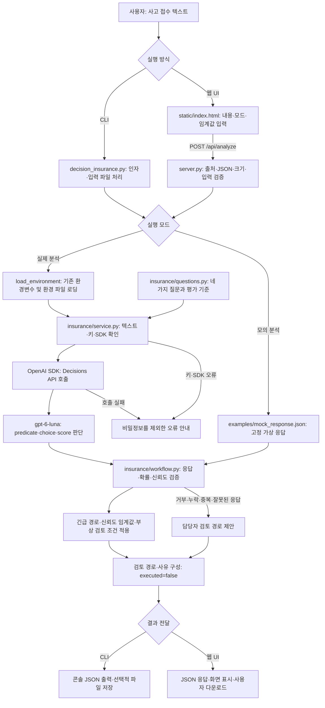

# 예제 4 - Decisions API를 이용한 보험 접수 분류 프로젝트

이 프로젝트는 지금까지 배운 OpenAI의 Decisions API 를 응용해 실제로 B2B에서 사용할만 한 응용 AI로 보험 접수 분류 프로젝트를 작성해 보았다. 보험 기록자가 사고 접수 문장을 받아 접수 대상 여부(predicate), 처리 경로(choice), 긴급도(score), 부상 관련 검토 필요성(predicate)을 평가한다.

## 1. 실제 OpenAI API 연결

실제 Decisions API를 사용하려면 `OPENAI_API_KEY`가 필요하다. `decisions-insurance` 프로젝트 루트의 `.env` 파일에 기존 API 키와 모델을 설정한다. `.env` 파일이 없다면 `.env.example`을 복사해 만든다.

다음과 같이 여러분의 API 키를 <Your_OpenAI_API_Key>에 대체해 입력한다.

``dotenv OPENAI_API_KEY=<Your_OpenAI_API_Key> OPENAI_DECISIONS_MODEL=gpt-6-luna ``

설정은 현재 환경변수 → `.env.local` → `.env` 순서로 적용한다. 앞에서 읽은 값은 뒤의 파일로 덮어쓰지 않는다. 키는 서버에서만 사용하며 브라우저에 전달하지 않는다.

실제 분석은 다음 명령으로 실행한다.

``powershell python decision_insurance.py --input examples/car_accident.txt --output output/car_accident_result.json ``

사고 접수 텍스트를 Decisions API에 전달해 접수 대상 여부, 처리 경로, 긴급도, 부상 관련 검토 필요성을 판단한다. 반환된 결과를 검증한 뒤 담당자의 검토 경로를 제안하고 JSON 파일로 저장한다. 실제 부서 배정이나 보험금 지급은 실행하지 않는다.

웹 화면은 `.\start-web.ps1`로 실행하고 http://127.0.0.1:8093 에 접속한다. 실제 분석 모드를 선택해야 API를 호출한다. 환경 설정을 변경했다면 서버를 재시작한다.

`--mock`은 고정 예제 응답만 사용하며 API를 호출하지 않는다. 실제 호출에는 API 사용료가 발생한다. 실제 키가 들어 있는 `.env`와 `.env.local`은 Git에 올리지 않는다.

## 2. Decisions-insurance 예제 실행

### 2-1. Windows 11 PowerShell

1) 가상환경 생성

```powershell
python -m venv .venv
```

2) 가상환경 활성화

```powershell
.\.venv\Scripts\Activate.ps1
```

3) 필요한 패키지 설치

```powershell
python -m pip install -U -r requirements.txt
```

4) 설치가 끝나면 모의 실행한다.

```powershell
python decision_insurance.py --mock
```

5) 콘솔에서 실제 실행은 다음과 같다.

```powershell
python decision_insurance.py --input examples/claim.txt --output output/result.json
```

### 2-2. macOS / Linux 운영체제에서 설치

```bash
cd decisions-insurance
python3 -m venv .venv
.venv/bin/python -m pip install -U -r requirements.txt
.venv/bin/python decision_insurance.py --input examples/claim.txt --output output/result.json
```

VS Code에서는 이 폴더를 열고 Python 인터프리터를 `.venv`로 선택한다. 명령은 VS Code 터미널에서도 그대로 사용할 수 있다.

### 2-3. API 키 없이 실행하려면?

모의 모드는 별도 패키지 설치가 필요 없다.

```bash
python decision_insurance.py --mock
```

고정된 가상 응답을 읽고 `MEDICAL_REVIEW`를 표시한다. 확률은 설명용으로 작성한 값이며 실제 모델 결과가 아니다. 임의 텍스트를 분석하지 않으므로 `--mock`과 `--input`을 함께 사용할 수 없다.

### 2-4. 웹 UI 실행

decisions-insurance 프로젝트 폴더에서 다음을 실행하고 http://127.0.0.1:8093 을 연다.

```powershell
.\start-web.ps1
```

일반 Python 환경에서는 기존 설치 절차 후 `python server.py`로 실행할 수 있다. 포트 변경은 `python server.py --port 8094` 또는 `./start-web.ps1 -Port 8094`를 사용한다. 종료는 실행 터미널에서 Ctrl+C를 누른다.

웹 화면에서 사고 내용 입력, 가상 예시 불러오기, 임계값 설정, 질문별 확률 및 검토 경로 확인, 전체 응답 보기와 JSON 다운로드를 지원한다. 실제 모드는 기존 `.env.local` 또는 `.env`의 키를 서버에서만 읽는다. 모의 모드는 입력 내용을 분석하지 않고 고정된 예시 응답만 표시한다. 사고 내용과 결과는 서버 파일로 자동 저장하지 않는다. 브라우저에서 JSON을 다운로드할 수 있다.

## 3. 아키텍처 플로우

decisions-insurance 프로젝트 소스를 기준으로 CLI와 웹 UI의 공통 분석 흐름을 정리한다.



### 3-1. 판단 질문과 역할

| 질문 이름                      | 유형          | 역할                                                  |
| ------------------------------ | ------------- | ----------------------------------------------------- |
| `valid_insurance_claim`      | `predicate` | 입력이 보험 사고 접수 대상으로 볼 수 있는지 판단한다. |
| `claim_route`                | `choice`    | 제공된 선택지 중 검토 경로를 선택한다.                |
| `urgency`                    | `score`     | 사고 접수의 긴급도를 순서가 있는 기준으로 평가한다.   |
| `medical_attention_required` | `predicate` | 부상·의료 관련 담당자 검토 필요성을 판단한다.        |

응답 형식과 확률 검증을 통과한 경우 긴급 경로를 우선한다. 일반 경로에서 선택 신뢰도가 임계값에 못 미치거나 자동 승인 후보인 경우 담당자 검토로 전환한다. 일반 손해사정 경로에서 부상 검토 확률이 임계값 이상이면 의료 검토를 제안한다.

실제 분석은 기존 키로 API를 호출하며 사용료가 발생한다. 모의 분석은 고정 응답만 사용하고 입력 내용을 분석하지 않는다. CLI의 `--mock`과 `--input`은 함께 사용할 수 없다. API 키는 서버 또는 CLI 프로세스에서만 사용한다.

결과는 담당자의 검토 경로를 제안할 뿐 실제 부서 배정이나 보험금 지급을 실행하지 않는다. `executed`는 항상 `false`다. CLI는 `--output`을 지정할 때 파일로 저장하고, 웹 서버는 사고 내용과 결과를 자동 저장하지 않는다.

## 4. 전체 폴더별 파일 구성

decisions-insurance 프로젝트 폴더의 파일들은 다음과 같다.

| 프로젝트 폴더                      | 파일명                    | 내용 및 역할                                                                                             |
| ---------------------------------- | ------------------------- | -------------------------------------------------------------------------------------------------------- |
| `decisions-insurance/`           | `.env.example`          | 실제 키 없이 OPENAI_API_KEY와 OPENAI_DECISIONS_MODEL 설정 양식을 제공한다.                               |
| `decisions-insurance/`           | `.gitignore`            | 실제 환경 파일, 가상환경, 캐시, 분석 결과 및 로그의 Git 업로드를 제외한다.                               |
| `decisions-insurance/`           | `README.md`             | 프로젝트 목적, 키 설정, CLI·웹 실행 방법과 처리 흐름을 안내한다.                                        |
| `decisions-insurance/`           | `decision_insurance.py` | CLI 인자를 처리하고 환경 설정, 실제·모의 분석, 검토 경로 계산, 콘솔 출력과 선택적 JSON 저장을 수행한다. |
| `decisions-insurance/examples/`  | `car_accident.txt`      | 주차 중 기둥과 접촉한 가상의 자동차 사고 접수 입력을 제공한다.                                           |
| `decisions-insurance/examples/`  | `claim.txt`             | 차량 후미 충돌과 부상 검토 상황을 담은 가상 사고 접수 입력을 제공한다.                                   |
| `decisions-insurance/examples/`  | `mock_response.json`    | API 호출 없이 사용하는 고정 가상 판단 응답을 제공한다.                                                   |
| `decisions-insurance/insurance/` | `__init__.py`           | 보험 접수 분류 모듈을 Python 패키지로 구성한다.                                                          |
| `decisions-insurance/insurance/` | `questions.py`          | 접수 대상 여부, 처리 경로, 긴급도, 부상 검토 질문과 선택지·평가 기준을 정의한다.                        |
| `decisions-insurance/insurance/` | `service.py`            | 입력·키·SDK를 확인하고 실제 Decisions API를 호출하며 비밀정보를 제외한 오류를 안내한다.                |
| `decisions-insurance/insurance/` | `workflow.py`           | 응답·확률·신뢰도를 검증하고 긴급성과 부상 검토 조건에 따라 담당자의 검토 경로를 제안한다.              |
| `decisions-insurance/`           | `requirements.txt`      | OpenAI SDK와 python-dotenv 등 실행 의존성을 정의한다.                                                    |
| `decisions-insurance/`           | `server.py`             | 표준 라이브러리 HTTP 서버로 화면, 가상 예제와 분석 API를 제공하고 요청 검증 및 오류 처리를 수행한다.     |
| `decisions-insurance/`           | `start-web.ps1`         | Windows PowerShell에서 프로젝트 가상환경으로 웹 서버를 실행하고 Port 인자로 포트를 지정한다.             |
| `decisions-insurance/static/`    | `index.html`            | 사고 내용 입력, 실제·모의 모드, 임계값 설정, 결과 표시 및 JSON 다운로드 웹 화면을 제공한다.             |
| `decisions-insurance/tests/`     | `test_server.py`        | 실제 모드의 입력 전달, 모의 모드의 API 미호출 및 잘못된 입력 거부를 검증한다.                            |
| `decisions-insurance/tests/`     | `test_workflow.py`      | 의료·긴급 검토, 판단 거부·누락·중복·낮은 신뢰도 처리와 자동 지급 미실행을 검증한다.                  |

## 5. 명령행 인자에 따른 실행 방식

프로젝트 폴더에서 다음 형식으로 실행한다.

```powershell
python decision_insurance.py [argument]
```

### 5-1. CLI 인자와 기본 동작

| 인자                  | 기본값                           | 실행에 미치는 영향                                                                                |
| --------------------- | -------------------------------- | ------------------------------------------------------------------------------------------------- |
| `--mock`            | 꺼짐                             | API 대신`examples/mock_response.json`의 고정 응답을 사용한다. API 키와 외부 패키지가 필요 없다. |
| `--input 파일경로`  | 프로젝트의`examples/claim.txt` | 실제 API에 전달할 UTF-8 사고 접수 텍스트 파일을 지정한다.                                         |
| `--model 모델명`    | 환경변수 또는`gpt-6-luna`      | 실제 API 호출에 사용할 모델을 지정한다.                                                           |
| `--threshold 숫자`  | `0.80`                         | API 응답을 받은 뒤 검토 경로를 결정할 임계값을 지정한다. 범위는`0~1`이다.                       |
| `--output 파일경로` | 저장 안 함                       | 콘솔 출력과 함께 결과를 JSON 파일로 저장한다. 상위 폴더는 자동 생성한다.                          |
| `--help`            | 해당 없음                        | 사용 가능한 인자를 출력하고 종료한다.                                                             |

인자가 없으면 기본 사고 파일로 실제 API를 호출한다. 실제 모드의 모델 선택 우선순위는 `--model` → `OPENAI_DECISIONS_MODEL` → `gpt-6-luna`다. 환경 설정은 기존 환경변수 → `.env.local` → `.env` 순서로 읽으며 먼저 설정된 값을 유지한다.

`--mock`과 `--input`을 함께 지정하면 오류로 종료한다. 모의 모드에서는 환경 파일을 읽지 않으며 `--model`은 실제 호출에 사용되지 않는다. `--threshold`는 고정 응답의 경로 계산에도 적용된다.

### 5-2. 실행 예시

다음 명령은 모두 프로젝트 폴더에서 실행한다.

```powershell
# 인자가 없으면 기본 사고 파일로 실제 API 호출
python decision_insurance.py

# API 호출 없이 고정 예제로 실행
python decision_insurance.py --mock

# 지정한 사고 파일로 실제 분석
python decision_insurance.py --input examples/car_accident.txt

# 모델과 임계값을 지정하고 결과 저장
python decision_insurance.py --input examples/claim.txt --model gpt-6-luna --threshold 0.90 --output output/result.json

# 모의 결과를 파일로 저장
python decision_insurance.py --mock --output output/mock_result.json

# 인자 도움말 확인
python decision_insurance.py --help
```

### 5-3. 임계값에 따른 검토 경로 분기

`--threshold`는 모델의 판단을 바꾸는 인자가 아니라 응답 이후의 분기 기준이다. 응답 형식과 확률 검증을 통과하면 다음 순서로 처리한다.

1. 선택 경로가 `EMERGENCY`이면 긴급 검토를 우선한다.
2. 경로 선택 신뢰도가 임계값보다 낮으면 `HUMAN_REVIEW`로 보낸다.
3. `AUTO_APPROVE`도 이 데모에서는 `HUMAN_REVIEW`로 보낸다.
4. `NORMAL_ADJUSTER`이면서 의료 검토 확률이 임계값 이상이면 `MEDICAL_REVIEW`로 바꾼다.
5. 그 외에는 선택된 경로를 유지한다.

임계값을 높이면 낮은 신뢰도로 담당자 검토에 넘어가기 쉬워지지만, 의료 검토 전환 조건은 더 엄격해진다. 응답 거부, 누락, 중복 또는 잘못된 형식이 발견되어도 담당자 검토로 전환한다.

결과 JSON은 `mode`, `decision`, `workflow`를 포함한다. 실제 부서 배정이나 보험금 지급은 실행하지 않으므로 `workflow.executed`는 항상 `false`다. `--output`이 없으면 콘솔에만 출력한다.

### 5-4. 웹 서버 실행 인자

웹 서버는 CLI 분석 프로그램과 별도로 포트 인자를 사용한다.

```powershell
python server.py --port 8094

# PowerShell 실행 스크립트 사용
.\start-web.ps1 -Port 8094
```

기본 포트(포트를 지정하지 않았을 때 사용하는 기본값)는 `8093`이다. 위 예시는 `http://127.0.0.1:8094`에서 접속한다. 웹의 실제·모의 분석 모드와 임계값은 화면에서 설정한다.

# 6. 참고 자료

* [OpenAI Developers - Decisions API](https://developers.openai.com/api/docs/guides/decisions)
* [decisions-insurance 예제 소스](https://github.com/synabreu/openai-decisions-workshop/tree/main/decisions-insurance)

